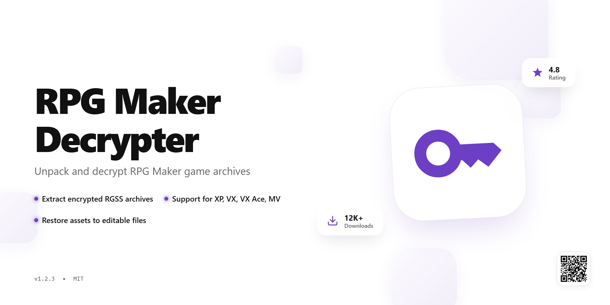

# 🗂️ RPG Maker Asset Decrypter & Inspector — Video Tool

### ⌨️ PowerShell Command Button

   

---

RPG Maker Decrypter turns locked game archives into an open visual playground, pairing lightning-fast extraction with a built-in inspector that lets you browse every recovered sprite, portrait, and sound file the moment it lands on disk. Instead of juggling separate utilities, you move straight from unpacking to previewing assets in one fluid loop, so you can see exactly what a project contains before touching a single line of code. Built for creators who like their workflow uninterrupted, it handles XP, VX, VXAce, MV, and MZ formats with the same snappy, inspection-first rhythm — giving you an accessible, unrestricted path through your own game files from start to finish.

## 📋 System Requirements

- Windows 10 or Windows 11
- PowerShell 5.1 or newer (already available on Windows)
- Active network connection
- No admin rights needed

## Features

* **⚡ Velocity first:** Archives unpack at a pace that feels almost instant — large XP/VX/VXAce projects and MV/MZ asset dumps land on disk before you can switch windows. Speed is the point, not a side effect.
* **🗂️ One dock for every engine:** XP, VX, VX Ace `.rgssad`/`.rgss2a`/`.rgss3a` archives and MV/MZ `.rpgmvp`/`.png_`, `.rpgmvo`/`ogg_`, `.rpgmvm`/`m4a_` assets all flow through the same window and the same one-click rhythm.
* **🔍 Look before you unpack:** built-in inspection lets you browse the contents of an archive as a visual tree — thumbnails for images, waveforms for audio, font previews for `ttf`/`otf` — so you can see exactly what you're extracting before a single file is written.
* **🖼️ Preview without leaving the tool:** images render in a proper viewer, audio plays straight from the archive, and fonts can be typed with live specimens. The decrypter doubles as a lightweight asset browser.
* **🔄 Round-trip workflow:** extract, swap, and repack the same data, image, audio, and font formats back into working archives — ideal for translation passes, asset replacement, and iterative edits without outside tooling.
* **🎛️ Drag, drop, go:** drop an archive or a folder of loose assets onto the window and the tool sorts out what it's looking at. No dialog mazes, no per-file configuration.
* **🧭 Batch-minded by design:** queue multiple archives and let the work run while you keep previewing — the interface stays responsive and the progress stays visible.
* **🛠️ Uniform handling across formats:** data, images, audio, and fonts follow the same inspect → preview → extract → repack loop, so skills learned on one engine carry straight into the next.
* **📦 Built for the everyday:** a single self-contained application with no external runtime to install — unpack it, launch it, and start working.

## How It Works

Every RPG Maker project is a sealed vault. The engine wraps its data, art, audio, and fonts behind archive formats and encrypted containers, and the runtime alone holds the key. This tool walks up to that vault and opens it in one clean motion.

The flow is direct by design:

- **Point it at a game folder.** The tool scans the directory and recognizes what it's working with — legacy `.rgssad`/`.rgss2a`/`.rgss3a` archives from XP, VX, and VXAce, or the per-asset encrypted containers (`.rpgmvp`/`.png_`, `.rpgmvo`/`.ogg_`, `.rpgmvm`/`.m4a_`) that MV and MZ produce.
- **Unseal in place.** Archive headers are parsed, keys are recovered, and every entry is unpacked and written out — the heavy lifting is built for speed, so large projects resolve quickly rather than grinding file by file.
- **Inspect while you go.** Unpacked assets don't just land on disk and disappear into a folder — the tool previews them inline. Images open as images, audio plays, and `.ttf`/`.otf` fonts render so you can see exactly what you've extracted instead of guessing from filenames.
- **Encrypt back.** The same pipeline runs in reverse: plain data, images, audio, and fonts can be repacked into the engine's native encrypted formats, giving you a full round trip from locked to open and back again.

Think of it as an x-ray for a game's contents: the archive is disassembled layer by layer, each piece held up to the light for inspection, and then set down in a tidy structure you can actually work with.

## Workflow

Start by dropping an archive onto the window, or point the tool at a folder of them — the decrypter picks up the RPG Maker generation on its own and gets to work. The archive types it recognizes (`.rgssad`, `.rgss2a`, `.rgss3a`) plus the MV/MZ asset extensions (`.rpgmvp`, `.rpgmvo`, `.rpgmvm`, and their underscore counterparts) are all handled the same way, so you never have to sort files by era before you begin. Everything streams through an optimized reader, so even large archives finish in a blink.

Once the contents are out, keep the inspector open beside the output folder. Data files like `rxdata`, `rvdata`, and `rvdata2` open for a quick look; images such as `png` preview inline; audio like `ogg` and `m4a` plays right there; and `ttf`/`otf` fonts render for a visual check. This is the part that turns a plain extraction into a curated library — you see exactly what you pulled before you move it into your project.

When you're ready to rebuild, the same window flips direction. Choose your payload — data, images, audio, or fonts — and the tool reassembles it back into an archive in seconds. Round-tripping an archive is a two-keystroke habit, which makes repeated test cycles feel effortless.

External editors and scripts slot into the same rhythm: dump an archive, tweak, re-pack, repeat. The decrypter stays out of your way and never leaves you waiting on a spinner. For the smoothest flow, keep one folder for pulled contents and one for rebuilt archives, and let the inspector be your quiet second pair of eyes.

## FAQ

**Is this tool accessible for newcomers?** Yes — the whole idea is to make archive unpacking feel less like a puzzle box. Point it at a file, watch it open, and the inspection pane shows you exactly what came out. No arcane setup ritual required.

- **Something looks different from a standard `.rgss3a` rip — is that expected?** This decrypter goes beyond the basic unpack: it reaches inside MV/MZ asset enclosures and lays the filenames back out the way authors intended them. If the output looks tidy, that's the point — like a drawer organizer for your game files.

- **Can I use it inside my own pipeline?** Absolutely. The workflow is deliberately visual and stepwise, so you can eyeball an archive before committing to a big batch, but the speed means you're never stuck waiting between peaks at the contents. Treat it like a light table for your archives: hold the film up, see the frames, then decide.

- **What does "extremely fast" actually mean in practice?** It means the bottleneck is your disk, not the tool. Large archives unfold at a pace that feels like scrolling a gallery rather than watching a progress bar. The built-in inspection keeps the momentum going — no exporting to a separate viewer just to see what you've got.

- **Will my encrypted assets open back up** — archive data and standalone images/audio alike? Yes; the same pass handles RPG Maker XP/VX/VXAce archives and the MV/MZ asset wrappers, so you get one tool for the whole shelf instead of a separate utility per format.

- **Can it help me organize a project's asset library?** That's where the visual workflow shines. Unpack, inspect, preview the images, audio, fonts — and let the contents tell you how they want to be grouped. It's less "extract and forget" and more "open the box and see everything at a glance."

- **Do I need a specific engine version?** It spans the classics — XP, VX, VX Ace — plus the newer MV/MZ asset formats. If it came out of an RPG Maker project, chances are it'll open here.

- **Where should I report a file that refuses to open?** Named issues help; describe the engine version and the file type and the community can take it from there. Treat odd cases as a curiosity to share — the tool grows by learning about new boxes to open.

## License

This project ships under a permissive, do-whatever-you-wish license — the kind that keeps the pipeline moving instead of tying it in knots. You are welcome to use RPG Maker Decrypter in personal projects, studio work, or commercial pipelines, to modify it, fold it into your own build, and pass it along to others.

What we ask in return is simple: keep the spirit of openness intact. If you redistribute a modified copy, rename it so nobody confuses your fork with the original, and carry the license text along with it. That way the visual identity of the tool stays clear and the workflow stays trustworthy for everyone down the chain.

The software is provided as-is, without warranty of any kind — express or implied. In plain terms: inspect assets, decrypt archives, and build your workflow with confidence, but you assume responsibility for how you use the results. The authors are not liable for any claim, damage, or other consequence arising from the tool or its output.

In short: take it, shape it, ship it — just keep the credits honest and the name distinct.